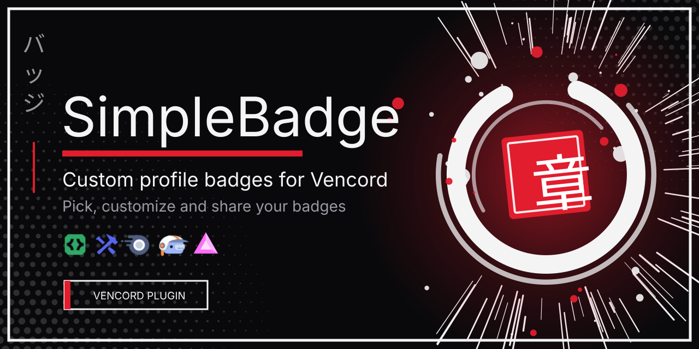
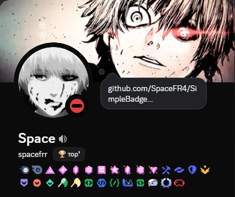

<p align="center">
  
</p>

A [Vencord](https://vencord.dev) user plugin that lets you add and customize Discord profile badges, and share them with everyone who uses the plugin.

Pick from a full catalog of Discord badges (Nitro, Booster, Staff, HypeSquad, Developer...), create your own custom badges, preview the result on a live profile card, and publish it. So other plugin users see your badges on your profile.

> **Note:** badges are purely visual and client-side. Only people who also have SimpleBadge installed can see them. They are not real Discord badges. Client mods are against Discord's Terms of Service, so use this plugin at your own risk.

---

## Features

### Badge catalog
- **Nitro**: Discord Nitro, Nitro Basic
- **Server Boosts**: Server Booster from 1 to 24 months (1, 2, 3, 6, 9, 12, 15, 18, 24)
- **Staff & Partners**: Discord Staff, Partnered Server Owner, Certified Moderator
- **HypeSquad**: Events, Bravery, Brilliance, Balance
- **Developers & Bots**: Active Developer, Early Verified Bot Developer, Supports Commands, Uses AutoMod, Verified Bot
- **Special & Achievements**: Bug Hunter (Level 1 and 2), Early Supporter, Quest Completed
- **Custom badges**: any icon (PNG, SVG or GIF URL), your own name and tooltip

### Customization studio
- **Live profile preview**: a Discord-style profile card (banner, avatar, name, username, badges) that updates as you pick badges
- **Search and categories** to find badges quickly
- **Reorder** your active badges (move up / down)
- **Edit the hover tooltip** of each badge (e.g. change the text or add a date)
- **JSON export / import** to back up or share your configuration

### Sharing
- **Keep local**: only your own client sees your badges
- **Publish for everyone**: syncs your badges so every plugin user sees them on your profile
- **Private secret key**: generated automatically and stored in your Vencord settings
- **Plugin Members tab**: browse everyone who published, search by username, ID or badge name
- **Automatic sync**: clients refresh the network database at startup and every 2 minutes, and right after you publish

---

## Installation

SimpleBadge is a Vencord **user plugin**, so you need Vencord built from source.

1. Follow the [Vencord developer guide](https://docs.vencord.dev/installing/) to set up the source (Git, Node.js and pnpm are required).
2. Open a cmd and go there:
   ```bash
   cd Vencord/src/userplugins
   ```
4. Execute this command:
   ```bash
   git clone https://github.com/SpaceFR4/SimpleBadge
   ```
6. Build and inject:
   ```bash
   pnpm build
   pnpm inject
   ```
7. Restart Discord completely, then enable **SimpleBadge** in **Settings → Vencord → Plugins**.

---

## Usage

1. Open the studio in any of these ways:
   - **Settings → Vencord → Plugins → SimpleBadge → Open Badge Creator**
   - The `/simplebadge` slash command
   - Right-click your own profile or avatar → **Badge Studio**
   - The Vencord toolbox → **Badge Creator**
2. Tick the badges you want in the catalog, or add a custom one at the bottom.
3. Reorder badges and edit tooltips in the **Active Badges** list. The profile card on top shows the result live.
4. Click:
   - **Keep local** to save only on your machine, or
   - **Publish for everyone** to share with the whole SimpleBadge network.

Use the **Sync badges** toolbox action (or the sync pill in the studio) to refresh other users' badges immediately.

---

## Preview

<p align="center">
  
</p>

- Plugin by **Space**
- Built on [Vencord](https://github.com/Vendicated/Vencord)
